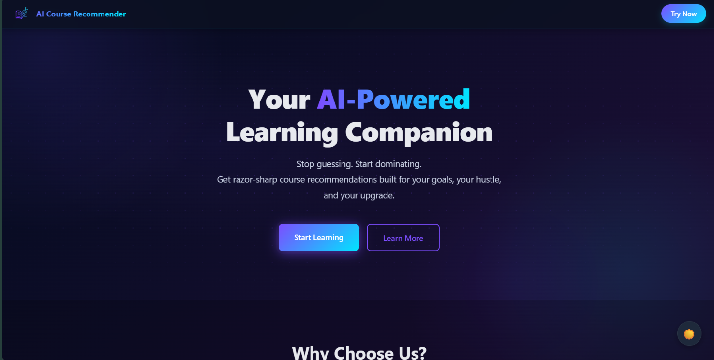
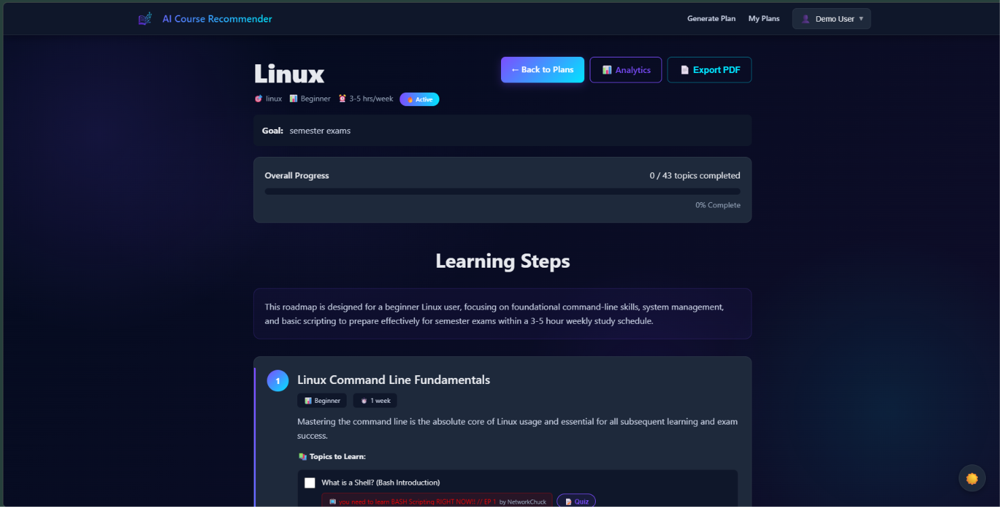
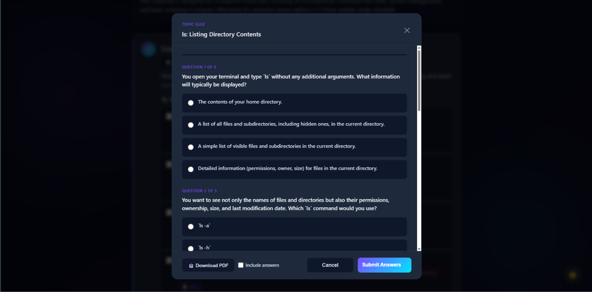
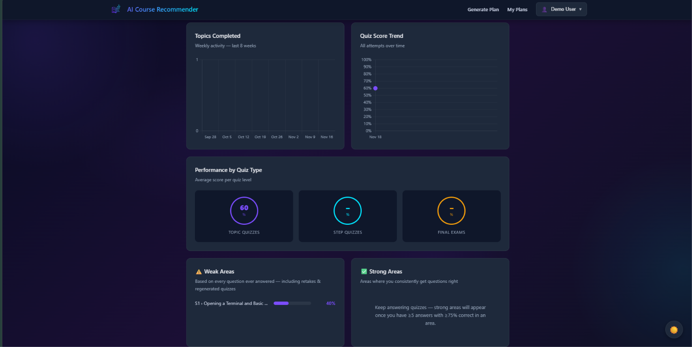

# 🎓 AI Course Recommender

> An AI-powered web application that builds a personalised, step-by-step learning roadmap, then tracks your progress and tests your knowledge with quizzes.

**Course:** SEC101 – Advanced Tools and Applications  
**Assignment:** Project Development Using Git, GitHub and Markdown

---

## 📌 Table of Contents

1. [Project Description](#-project-description)
2. [Objectives](#-objectives)
3. [Team Members and Contributions](#-team-members-and-contributions)
4. [Features](#-features)
5. [Technologies Used](#-technologies-used)
6. [Project Structure](#-project-structure)
7. [Installation and Execution](#-installation-and-execution)
8. [Screenshots](#-screenshots)
9. [Git and GitHub Workflow](#-git-and-github-workflow)
10. [Security Notes](#-security-notes)

---

## 📖 Project Description

**AI Course Recommender** helps learners who don't know where to start. The user tells the app about their interests, goals and skill level, and the app uses the **Google Gemini API** to generate a structured learning plan made of steps and topics, with suggested video resources.

Users can save plans, mark topics as complete, write notes, and take **AI-generated quizzes** at topic, step and plan level. A **dashboard** then analyses quiz results to show strong areas, weak areas and learning trends.

## 🎯 Objectives

- Generate a **personalised learning roadmap** from a learner's interests, goals and skill level.
- Let learners **track progress** topic by topic across multiple saved plans.
- **Assess understanding** with automatically generated quizzes.
- **Identify weak areas** using AI analysis of past quiz answers.
- Practise professional teamwork tools: **Git, GitHub, branching, pull requests, code review and Markdown documentation**.

## 👥 Team Members and Contributions

| Name | Roll No. | GitHub | Contribution |
| ---- | -------- | ------ | ------------ |
| Ayush | 18 | [@ccbakm](https://github.com/ccbakm) | Completed this assignment individually: repository setup, feature branches, pull requests and reviews, merge-conflict resolution, and Markdown documentation |

> A detailed breakdown of commits, branches, pull requests and reviews is in [CONTRIBUTING.md](CONTRIBUTING.md).

## ✨ Features

1. **User accounts** – registration, login, logout and a profile/settings page (name, email, skill level, password change). Passwords are stored as secure hashes.
2. **AI learning-plan generation** – personalised roadmap created with the Gemini API.
3. **Video suggestions** – optional YouTube links for each topic (needs a YouTube API key).
4. **Plan management** – save plans, view all plans, set one plan as *active*, delete plans, and search saved plans by title or domain.
5. **Progress tracking** – mark topics complete and see overall completion.
6. **Notes** – write and save notes against topics in a plan.
7. **AI-generated quizzes** – three levels: topic (5 questions), step (10 questions) and full plan (50 questions). Quizzes are cached and answers are logged.
8. **Weak-point analysis** – AI summary of the areas where the learner needs more practice.
9. **Analytics dashboard** – topics completed, quiz score trend, performance by quiz type, weak and strong areas, and learning insights.
10. **Light / dark theme** with an animated background.

## 🛠️ Technologies Used

| Layer | Technology |
| ----- | ---------- |
| Backend | PHP (PDO, sessions, cURL) |
| Database | MySQL / MariaDB |
| Frontend | HTML5, CSS3, vanilla JavaScript |
| AI | Google Gemini API (`gemini-2.5-flash`) |
| Video resources | YouTube Data API v3 *(optional)* |
| Local server | XAMPP (Apache + MySQL) |
| Version control | Git and GitHub |

## 📁 Project Structure

```text
ai_course_recommender/
├── api/                      # JSON endpoints used by the front end
│   ├── recommend.php         #   generate a learning plan (Gemini + YouTube)
│   ├── save-plan.php         #   save a generated plan
│   ├── delete-plan.php       #   delete a plan
│   ├── toggle-active.php     #   set the active plan
│   ├── update-progress.php   #   mark topics complete / incomplete
│   ├── save-note.php         #   save notes
│   ├── generate-quiz.php     #   create (or load cached) quizzes
│   ├── submit-quiz.php       #   store quiz attempts and answers
│   ├── analyze-weakpoints.php#   AI weak-point analysis
│   └── dashboard-data.php    #   analytics for the dashboard
├── assets/                   # CSS, JavaScript and images
├── partials/                 # shared header and footer
├── docs/screenshots/         # screenshots used in this README
├── config.example.php        # configuration template (copy to config.php)
├── database_schema.sql       # database tables and a demo user
├── index.php                 # landing page
├── register.php / login.php / logout.php / profile.php
├── recommender.php           # plan-generation form
├── my-plans.php              # list of saved plans
├── plan-details.php          # plan view: steps, progress, notes, quizzes
├── dashboard.php             # analytics dashboard
├── CONTRIBUTING.md
└── README.md
```

## 🚀 Installation and Execution

### Prerequisites

- [XAMPP](https://www.apachefriends.org/) (Apache + MySQL/MariaDB + PHP)
- [Git](https://git-scm.com/downloads)
- A free **Gemini API key** from [Google AI Studio](https://aistudio.google.com/apikey)
- *(Recommended)* A **YouTube Data API v3 key** from [Google Cloud Console](https://console.cloud.google.com/) – see the note in step 4

### Steps

**1. Start XAMPP** and turn on **Apache** and **MySQL**.

**2. Clone the repository into XAMPP's `htdocs` folder**

```bash
cd C:\xampp\htdocs
git clone https://github.com/ccbakm/ai_course_recommender.git
```

> ⚠️ Keep the folder name `ai_course_recommender`. If you rename it, update `$APP_BASE` in `config.php`.

**3. Create the database** – open [phpMyAdmin](http://localhost/phpmyadmin), choose **Import**, and select `database_schema.sql`. Or from the command line:

```bash
C:\xampp\mysql\bin\mysql -u root < database_schema.sql
```

**4. Add your configuration**

```bash
cd ai_course_recommender
copy config.example.php config.php        # Windows
# cp config.example.php config.php        # macOS / Linux
```

Open `config.php` and set your keys:

```php
$GEMINI_API_KEY  = 'paste-your-gemini-key-here';
$YOUTUBE_API_KEY = 'paste-your-youtube-key-here';   // recommended
```

> 🎥 **About the YouTube key:** with a key, every topic in a learning plan links to a specific, relevant YouTube video. Without it, the app still works, but each topic links to a YouTube *search results* page instead.
>
> To get a key: open [Google Cloud Console](https://console.cloud.google.com/) → **APIs & Services → Library** → enable **YouTube Data API v3** → **Credentials → Create credentials → API key**.

**5. Open the app** at <http://localhost/ai_course_recommender/>

### Demo account

| Email | Password |
| ----- | -------- |
| `demo@example.com` | `password` |

*Or create your own account from the **Get Started** button.*

## 🖼️ Screenshots

| Home page | Generated learning plan |
| --------- | ----------------------- |
|  |  |

| Quiz | Analytics dashboard |
| ---- | ------------------- |
|  |  |


## 🔀 Git and GitHub Workflow

- `main` always holds the stable, working version.
- New work is done on **feature branches** and merged into `main` through **pull requests** after review.
- Commit messages are short and descriptive, for example: `Add quiz score trend chart`.

Full details are in [CONTRIBUTING.md](CONTRIBUTING.md). To see the history:

```bash
git log --oneline --graph --all
```

## 🔒 Security Notes

- **Never commit `config.php`** – it holds your API keys and is listed in `.gitignore`.
- If a key is ever pushed by accident, **revoke it immediately** in Google AI Studio / Google Cloud Console and create a new one.
- The demo account is for local testing only.

---

*Made for SEC101 – Advanced Tools and Applications.*
